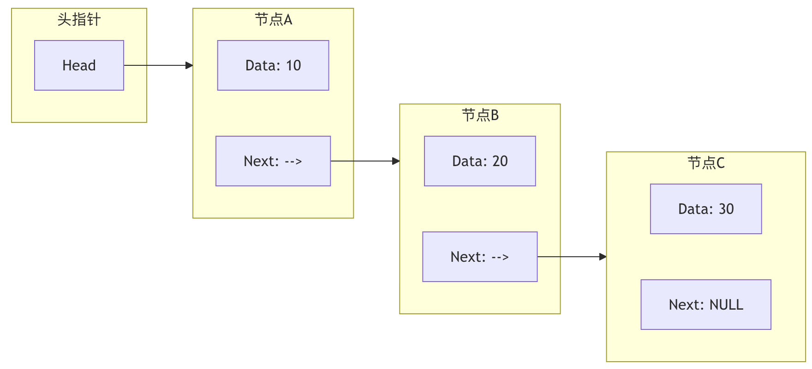

# 线性数据结构

### 数组（Array）

#### 静态数组

|特性|描述|时间复杂度|
|---|---|---|
|访问元素|通过索引直接访问|O(1)|
|插入元素|需要移动后续元素|O(n)|
|删除元素|需要移动后续元素|O(n)|
|空间分配|固定大小，预先分配|O(1)|

#### 动态数组

|特性|描述|时间复杂度|
|---|---|---|
|访问元素|通过索引直接访问|O(1)|
|插入元素|可能需要扩容和复制|平均O(1)，最坏O(n)|
|删除元素|需要移动后续元素|O(n)|
|空间分配|自动扩容|O(n)（扩容时）|

### 链表（Linked List）

#### 单向链表

|操作|描述|时间复杂度|
|---|---|---|
|访问元素|需要从头遍历|O(n)|
|头部插入|直接插入|O(1)|
|尾部插入|需要遍历到尾部|O(n)|
|中间插入|需要先找到位置|O(n)|
|删除元素|需要先找到位置|O(n)|

#### 双向链表

|操作|描述|时间复杂度|
|---|---|---|
|访问元素|需要从头或尾遍历|O(n)|
|头部插入|直接插入|O(1)|
|尾部插入|直接插入（如果有尾指针）|O(1)|
|中间插入|需要先找到位置|O(n)|
|删除元素|需要先找到位置|O(n)|

### 栈（Stack）

|操作|描述|时间复杂度|
|---|---|---|
|push(入栈)|在栈顶添加元素|O(1)|
|pop(出栈)|移除栈顶元素|O(1)|
|peek(查看)|查看栈顶元素|O(1)|
|isEmpty(判空)|检查栈是否为空|O(1)|

### 队列（Queue）

|操作|描述|时间复杂度|
|---|---|---|
|enqueue(入队)|在队尾添加元素|O(1)|
|dequeue(出队)|移除队头元素|O(1)|
|front(查看队头)|查看队头元素|O(1)|
|isEmpty(判空)|检查队列是否为空|O(1)|

## 数组
### 基本概念与特点

- **连续存储**：数组在内存中占据一块 **连续** 的空间，就像公寓楼里房间是紧挨着的。
- **固定大小**：数组在创建时就需要确定其容量（长度），之后通常不能改变，就像公寓楼盖好后房间数就固定了。
- **索引访问**：每个元素（房间）都有一个唯一的编号，称为 **索引**。在大多数编程语言中，索引从 `0` 开始。你可以通过索引直接、快速地访问任何一个元素，时间复杂度为 `O(1)`。

### 优点与缺点

| 优点                            | 缺点                                        |
| :---------------------------- | :---------------------------------------- |
| **高速随机访问**：通过索引可在常数时间内访问任何元素。 | **大小固定**：静态数组一旦创建，容量难以改变。                 |
| **内存效率高**：连续存储，无需额外空间存储元素间关系。 | **插入/删除成本高**：在中间插入或删除元素，需要移动大量后续元素以保持连续性。 |

## 链表：数据的寻宝火车

当数组的固定大小和插入删除的低效成为问题时，链表就登场了。链表像一列 **火车**，每节车厢（节点）都装载着货物（数据），并通过挂钩（指针）连接下一节车厢。

### 基本概念与类型

链表的每个 **节点** 至少包含两部分：

1. **数据域**：存储实际的数据值。
2. **指针域**：存储下一个节点在内存中的地址。

链表主要类型：

- **单向链表**：节点只指向下一个节点。
- **双向链表**：节点同时指向前一个和后一个节点，可以双向遍历。
- **循环链表**：尾节点指向头节点，形成一个环。

# 图论结构

### 图的基本术语

|术语|定义|生活比喻|符号表示|
|---|---|---|---|
|**顶点（Vertex）**|图中的基本单元|社交网络中的人|V, u, v|
|**边（Edge）**|连接两个顶点的线|两人之间的关系|E, (u,v)|
|**度（Degree）**|顶点连接的边数|一个人的好友数量|deg(v)|
|**路径（Path）**|顶点的序列|从A到B的路线|v₁→v₂→…→vₙ|
|**环（Cycle）**|起点和终点相同的路径|从家出发最终回家|v₁→v₂→…→v₁|
|**连通图**|任意两点间都有路径|所有人都能互相联系||
|**权重（Weight）**|边的数值属性|两城市间的距离|w(u,v)|

### 图的分类

| 分类标准    | 类型       | 特点      | 应用场景      |
| ------- | -------- | ------- | --------- |
| **方向性** | **无向图**  | 边没有方向   | 好友关系、道路网络 |
|         | **有向图**  | 边有方向    | 关注关系、工作流程 |
| **权重**  | **无权图**  | 所有边权重相同 | 社交网络关系    |
|         | **有权图**  | 边有不同权重  | 地图距离、网络流量 |
| **连通性** | **连通图**  | 任意两点可达  | 交通网络      |
|         | **非连通图** | 存在孤立点   | 社交群体      |
| **环**   | **无环图**  | 没有环路    | 任务依赖、家族树  |
|         | **有环图**  | 包含环路    | 道路网络      |

# 贪心算法
### 贪心算法的特点

- **贪心选择性质**：每一步的最优解，都可以由之前各步的局部最优解推导出来。后面的选择不会影响之前的选择。
- **最优子结构**：一个问题的最优解包含其子问题的最优解。这是动态规划也具有的性质，但贪心算法在每一步都"贪心地"选择子问题的最优解。

|特点|描述|优点|缺点|
|---|---|---|---|
|**局部最优**|每步选择当前最优解|简单直观|可能不是全局最优|
|**不可撤销**|选择后不能反悔|决策快速|容易陷入局部最优|
|**高效性**|通常时间复杂度低|实用性强|适用范围有限|
|**简单实现**|逻辑清晰易懂|易于编码|需要证明正确性|

### 与动态规划的区别

这是一个初学者容易混淆的点。我们用表格来对比一下：

| 特性        | 贪心算法                                 | 动态规划                            |
| :-------- | :----------------------------------- | :------------------------------ |
| **决策依据**  | 每一步都做出当前最优选择，**不可回退**。               | 每一步的选择依赖于子问题的解，会保存中间结果，可比较多种选择。 |
| **最优解保证** | 不一定能得到全局最优解，需要问题本身具有贪心选择性质。          | 通常能得到全局最优解。                     |
| **效率**    | 高效，通常时间复杂度较低。                        | 相对较低，因为需要解决重叠子问题。               |
| **适用场景**  | 问题具有贪心选择性质和最优子结构，如 Huffman 编码、最小生成树。 | 问题具有最优子结构和重叠子问题，如背包问题、最短路径。     |

简单来说，**动态规划是"谋定而后动"，会为了长远利益牺牲眼前；而贪心算法是"今朝有酒今朝醉"，只追求眼前利益。**
