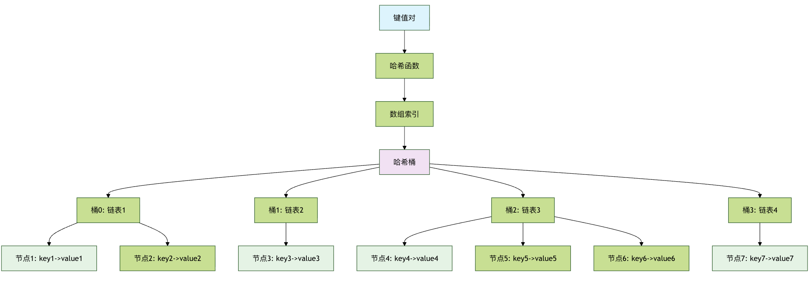
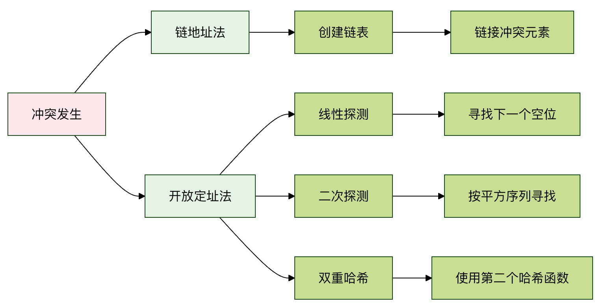

### 常见哈希函数

| 类型        | 示例                                            | 适用场景   |     |
| --------- | --------------------------------------------- | ------ | --- |
| **除法取余法** | `hash = key % table_size`                     | 整数键    |     |
| **乘法取整法** | `hash = floor(key * A % 1 * table_size)`      | 浮点数键   |     |
| **数字分析法** | 分析数字的分布规律                                     | 特定模式数据 |     |
| **平方取中法** | `hash = (key * key) // 10^(n/2) % table_size` | 数字键    |     |
| **字符串哈希** | 逐字符处理                                         | 字符串键   |     |

### 哈希表结构图

### 冲突解决方法对比

## 哈希冲突与解决方法

**哈希冲突**是指两个或更多不同的键，经过哈希函数计算后，得到了相同的数组索引。就像电影院的两个观众被分配了同一个座位号，这显然是个问题。冲突是不可避免的，因为哈希值的范围（数组大小）通常是有限的，而可能的键是无限的。

解决冲突主要有两种经典方法：

### 方法一：链地址法

这是最常用的方法。它不把数据直接放在数组的每个位置，而是在每个数组位置存放一个**链表**（或其他数据结构，如红黑树）。当发生冲突时，新的键值对就被添加到这个位置的链表中。

**过程描述：**

计算键的哈希值，找到数组索引。

- 如果该索引位置的链表为空，则创建一个新节点存储键值对。

    如果链表不为空（发生冲突），则遍历这个链表。

    - 如果找到了相同的键，则更新其值（或根据需求处理）。
    - 如果没找到相同的键，则将新的键值对添加到链表末尾。

import java.util.LinkedList;

/**
 * 使用链地址法解决冲突的哈希表实现
 */
public class HashTableChaining {

    // 内部类：表示一个键值对节点
    private static class Entry {
        String key;    // 键
        String value;  // 值

        Entry(String key, String value) {
            this.key = key;
            this.value = value;
        }
    }

    private int size;                          // 底层数组大小
    private LinkedList<Entry>[] table;         // 底层数组，每个元素是一条链表

    /**
     * 初始化哈希表
     * @param size 底层数组的初始大小
     */
    @SuppressWarnings("unchecked")
    public HashTableChaining(int size) {
        this.size = size;
        // Java 中不能直接创建泛型数组，需要先创建原始类型再强转
        this.table = new LinkedList[size];
        // 每个桶初始化为一个空链表
        for (int i = 0; i < size; i++) {
            table[i] = new LinkedList<>();
        }
    }

    /**
     * 内部哈希函数：用 key 的 hashCode 对数组大小取模
     * @param key 键
     * @return 数组下标
     */
    private int hash(String key) {
        // Java 中 hashCode() 可能返回负数，所以要用 Math.abs 取绝对值
        return Math.abs(key.hashCode()) % size;
    }

    /**
     * 向哈希表中插入一个键值对
     * @param key   键
     * @param value 值
     */
    public void insert(String key, String value) {
        int index = hash(key);                 // 计算下标
        LinkedList<Entry> bucket = table[index]; // 获取对应的桶

        // 遍历桶，检查键是否已存在
        for (Entry entry : bucket) {
            if (entry.key.equals(key)) {
                // 键已存在，更新值
                entry.value = value;
                return;
            }
        }
        // 键不存在，添加到链表末尾
        bucket.add(new Entry(key, value));
    }

    /**
     * 根据键获取值，如果键不存在则返回 null
     * @param key 键
     * @return 对应的值，或 null
     */
    public String get(String key) {
        int index = hash(key);
        LinkedList<Entry> bucket = table[index];

        for (Entry entry : bucket) {
            if (entry.key.equals(key)) {
                return entry.value;
            }
        }
        return null; // 键不存在
    }

    /**
     * 根据键删除键值对
     * @param key 键
     * @return 删除成功返回 true，键不存在返回 false
     */
    public boolean delete(String key) {
        int index = hash(key);
        LinkedList<Entry> bucket = table[index];

        for (int i = 0; i < bucket.size(); i++) {
            if (bucket.get(i).key.equals(key)) {
                bucket.remove(i); // 从链表中删除该节点
                return true;      // 删除成功
            }
        }
        return false; // 键不存在，删除失败
    }

    /**
     * 打印哈希表的所有内容
     */
    public void display() {
        for (int i = 0; i < size; i++) {
            System.out.print("索引 " + i + ": [");
            LinkedList<Entry> bucket = table[i];
            for (int j = 0; j < bucket.size(); j++) {
                Entry entry = bucket.get(j);
                System.out.print("(" + entry.key + ", " + entry.value + ")");
                if (j < bucket.size() - 1) {
                    System.out.print(", ");
                }
            }
            System.out.println("]");
        }
    }

    /**
     * 使用示例
     */
    public static void main(String[] args) {
        System.out.println("\n--- 链地址法哈希表示例 ---");
        HashTableChaining phoneBook = new HashTableChaining(5);

        phoneBook.insert("Alice", "123-4567");
        phoneBook.insert("Bob", "987-6543");
        phoneBook.insert("Charlie", "555-1234");
        // 假设 "David" 的哈希值与 "Alice" 冲突（为了演示）
        phoneBook.insert("David", "111-2222");

        System.out.println("插入数据后的哈希表：");
        phoneBook.display();

        System.out.println("\n查找 'Bob' 的电话: " + phoneBook.get("Bob"));
        System.out.println("查找不存在的 'Eve': " + phoneBook.get("Eve"));

        phoneBook.delete("Charlie");
        System.out.println("\n删除 'Charlie' 后的哈希表：");
        phoneBook.display();
    }
}

## 哈希表的性能与负载因子

哈希表的效率高度依赖于一个关键指标：**负载因子**。

**负载因子 = 哈希表中已存储的元素数量 / 哈希表数组的总大小**

- **负载因子低**（如 0.5）： 意味着数组还有很多空位，冲突概率小，操作速度快。
- **负载因子高**（如 0.9）： 意味着数组快满了，冲突概率急剧增加，链表变长或探测距离变长，性能下降。

为了保持高性能，当负载因子超过某个阈值（例如 0.75）时，哈希表会进行**扩容**操作：

1. 创建一个新的、更大的数组（通常是原大小的两倍）。
2. 遍历旧哈希表中的所有键值对。
3. 根据新的数组大小，用哈希函数重新计算每个键的索引，并将其插入到新数组中。

这个过程称为 **Rehashing**，虽然耗时，但能显著降低负载因子，使哈希表恢复高效。
